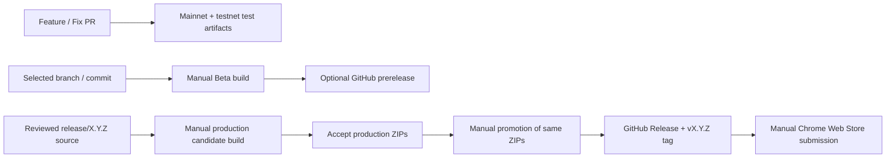

# Noir Wallet CI/CD and Release Workflow

This runbook describes extension verification in [build-extension.yml](../.github/workflows/build-extension.yml), manual Beta and production candidate builds in [extension-release.yml](../.github/workflows/extension-release.yml), and promotion in [publish-extension.yml](../.github/workflows/publish-extension.yml). The [documentation workflow](../.github/workflows/docs.yml) verifies the documentation site on relevant pull requests but does not deploy it. The [SDK workflow](../.github/workflows/sdk.yml) checks the SDK package and example from this workspace without publishing them. Website and voting Worker deployment are described in [Website and Voting Worker](#website-and-voting-worker). SDK npm publication and Chrome Web Store submission remain separate manual operations.

## Website and Voting Worker

The website at `https://www.zknoir.com/` keeps its existing Cloudflare Pages Git integration. It builds and publishes the independent `/frost` page with the rest of the website. The [Website Voting Worker workflow](../.github/workflows/web-vote.yml) deploys only `packages/web-vote/`, independently of Pages and wallet releases. Homepage traffic continues to use Pages; voting API routing is defined in the [Worker configuration](../packages/web-vote/wrangler.jsonc).

### One-Time Deployment Credentials

In the GitHub repository, open **Settings → Secrets and variables → Actions** and add these repository secrets:

| Secret                  | Value                                                                                     |
| ----------------------- | ----------------------------------------------------------------------------------------- |
| `CLOUDFLARE_ACCOUNT_ID` | The Cloudflare account containing the website's zone and the voting Worker                |
| `CLOUDFLARE_API_TOKEN`  | A Cloudflare API token authorized to deploy the Worker and manage its routes in that zone |

Follow [Cloudflare's GitHub Actions authentication guide](https://developers.cloudflare.com/workers/ci-cd/external-cicd/github-actions/) to create a token using the **Edit Cloudflare Workers** template and restrict it to the intended account and website zone. See [Workers permissions](https://developers.cloudflare.com/workers/authorization/workers/) for Worker creation and route permissions. Store the token in Actions secrets, never in source files or frontend build variables. The configured hosts must use Cloudflare-proxied DNS for Worker routes.

### Automatic Deployment and Recovery

- Relevant pushes to `main` verify the Worker, test and build the voting client, then deploy the production Worker. The workflow's path filters define relevant changes.
- Pull requests run verification without deployment or access to the deployment credentials. Forks do not deploy.
- Manual runs can deploy from `main`; other branches only verify. Missing credentials fail deployment with a configuration error.
- Deployment uses the committed Wrangler configuration, including the Durable Object binding and migration. Existing stored votes are preserved; local test votes are not uploaded.
- Before deployment, the run's commit must still match current `main`. Rerunning an older workflow cannot replace a newer Worker deployment; start a new manual run from current `main` instead.
- The final step performs an anonymous, read-only request to the production API and validates its response against the client contract. It does not submit a production vote.

After pushing, check **Actions → Website Voting Worker** and the existing Pages deployment status. These are independent deployments; the page may publish before its API is ready. If credential or route setup fails, correct the relevant account, token, or DNS configuration and rerun the workflow from `main`. If the post-deployment API check fails, inspect the route and API response: the deployment may already have succeeded. Do not remove the Durable Object or reset votes to recover a failed deployment. For a code regression, revert the affected change on `main` and let the normal deployment workflow publish the correction. No production deployment is verified merely by a local dry run.

## Branches and Releases

- `main` is the integration branch. Submit features and fixes through short-lived pull request branches; `v2` is also an extension verification target.
- Relevant pull requests and pushes targeting `main`, `v2`, or `release/**` run core checks. Extension source, WASM, or build-dependency changes also build both networks as Actions artifacts. Tests, release tooling, and package documentation alone skip ZIP builds. Automatic verification does not publish GitHub Releases.
- Manual Beta builds select a repository branch or full commit SHA without requiring a merge to `main`.
- A temporary `release/{version}` branch holds the reviewed production source. For a partial release or hotfix, start from a verified stable wallet source commit or a real production source tag, and cherry-pick only the intended changes. Historical migration tags are not usable source baselines; see [historical Releases](#historical-releases).
- Build a production candidate, accept its production ZIPs, then run a separate manual promotion. Promotion publishes those exact bytes and creates `v{version}` on the accepted source commit. Pushing a tag alone does not publish.
- The canonical `NoirWallet/noir-wallet` repository publishes wallet Releases even while private. Other public, non-fork repositories also publish to themselves. Forks and other private repositories retain Actions build artifacts without publishing Releases.
- Release workflow definitions must run from `main`; the source input selects wallet code independently. Keep the release branch until promotion completes, then merge applicable fixes back to integration branches and remove the temporary branch.



### Preview and Beta labels

Automatic verification runs when extension, workspace build configuration, changelog, WASM lock, test, or workflow paths match the path filters. Core checks always run; ZIP builds additionally require changes to extension files outside tests and Markdown documentation, or root build inputs (`package.json`, lockfile, workspace config, Node version, TypeScript config, `.npmrc`, WASM lock, or license). Pushes without a locally available previous commit also build ZIPs. PR metadata records the tested merge commit plus PR head and base commits. Download generated artifacts from **Actions → Build Extension**; their retention is seven days. For a tooling-only PR that needs a real ZIP check, use the manual Beta build with publication disabled. Ignored local UI tools and `output/` are not committed or release triggers.

Manual builds generate labels containing the run ID, attempt, and source commit; do not create them manually:

```text
v{version}-beta.{run ID}.{attempt}.{short source SHA}
v{version}-rc.{run ID}.{attempt}.{short source SHA}
```

Multiple Betas can use the same extension version. Manual runs are queued rather than cancelling an earlier build. Candidate labels identify Actions artifacts only; a candidate does not create a tag or Release. Manual build artifacts are retained for 30 days.

### Manual confirmation and production validation

Both manual workflows require repository write access and must be dispatched from `main`. Candidate construction requires confirmation of the full reviewed source SHA. Publication requires a separate dispatch with the accepted candidate run ID, attempt, and full source SHA. These are maintainer confirmations; the workflows do not enforce a second independent reviewer. GitHub environment required reviewers are not a prerequisite because that feature is unavailable on non-Enterprise private repositories. See [manual workflow permissions](https://docs.github.com/en/actions/how-tos/manage-workflow-runs/manually-run-a-workflow) and [environment review availability](https://docs.github.com/en/actions/how-tos/deploy/configure-and-manage-deployments/review-deployments).

Candidate packaging and promotion enforce:

1. The source branch is `release/` plus the numeric version in `packages/extension/package.json`, and its resolved commit matches the manually confirmed full SHA.
2. The candidate uses production build settings and includes both networks.
3. `CHANGELOG.md` has exactly one nonempty `## [version]` section for that version.
4. `packages/web/public/changelog.json` has a matching entry accepted by the wallet's release-notes parser.

Promotion additionally verifies a successful candidate workflow dispatched from this repository's `main`, the exact run attempt and artifact ID, artifact metadata, both ZIP checksums, and unchanged release branch HEAD. A Beta or PR artifact cannot be promoted. Source code need not be contained in `main`. Existing production tags are never moved, and published assets are never overwritten.

## Workflow Stages

### Prepare

Resolve the selected branch once to a full source SHA and read its extension version. Candidates additionally confirm the source SHA and matching release branch. Checkout the pinned source for testing and building. The trusted packaging job validates developer changelog and user-facing notes before exposing a candidate for acceptance.

### Verify

Every run executes:

```bash
pnpm install --frozen-lockfile
pnpm verify-wasm-pkg
pnpm test
```

`verify-wasm-pkg` checks the vendored WASM provenance metadata, file inventory, sizes, and SHA-256 values against `wasm-package.lock.json`. CI does not build or download WASM; both network builds use the same committed package. Beta and production use the same deterministic core tests. UI, Playwright, and hardware checks are local development activities, not automated release gates.

Before promotion, run `pnpm audit --prod` and `pnpm audit` against the frozen lockfile. Review each reported dependency path and affected API against the shipped extension bundles; apply compatible fixes and assess any remaining findings before release.

### Build

After verification, both networks are built in order:

```bash
pnpm build:extension
pnpm build:extension:testnet
```

`BUILD_CHANNEL` is `beta` for PR, push, and Beta builds, or `production` for candidates. Mainnet and testnet use separate output directories and ZIP assets. Pull requests run core tests and both extension builds without publishing or receiving production analytics secrets.

Build jobs keep read-only repository permissions. Manual builds upload the two network ZIPs to a fresh packaging job that executes tooling from the trusted workflow commit. It downloads ZIPs into a new directory outside the selected wallet checkout and reads only version and release-note data from that checkout. The final artifact contains both ZIPs, `SHA256SUMS`, `release-metadata.json`, and `release-body.md`. Metadata binds the files to their source commit, build channel, repository, workflow commit, run ID, and attempt. Repository retention policies can shorten the requested retention.

Production mainnet candidate builds require the repository secrets `GA_API_SECRET` and `CUSTOM_ANALYTICS_PASSWORD`. The workflow injects them only into the mainnet build step after the source SHA confirmation; a missing value stops the build. Local default builds, Beta builds, testnet builds, and local browser verification do not embed these values. For a local production mainnet build, supply the same environment variables through your shell and set `BUILD_CHANNEL=production`.

Analytics values embedded in the extension are visible to its users. They must not grant privileged server access or be relied on as confidential authentication. Rotate previously committed values before exposing repository history, and configure the replacements in repository secrets without committing them.

### Publish

The publish job runs in `NoirWallet/noir-wallet` regardless of visibility, and in other public, non-fork repositories. It downloads the exact artifact ID, validates provenance and checksums, and publishes to `github.repository`. Only publication jobs receive `contents: write`; they use the built-in `GITHUB_TOKEN`. Production promotion executes no wallet source code and performs no build. Releases in a private repository are visible only to people with repository access.

- Beta uses a prerelease and is not marked Latest. Its tag points to the wallet source commit that produced the ZIPs.
- Production creates `v{version}` at the accepted source SHA and is marked Latest. If that tag already exists, it must resolve to the same source commit. Earlier prereleases remain available.
- Production notes come from the matching `CHANGELOG.md` section. Each Release includes a source commit link, both ZIPs, and `SHA256SUMS`.

Production assets are `noir-wallet-v{version}.zip` and `noir-wallet-v{version}-testnet.zip`; candidate artifacts already use these filenames. Beta asset names include the Beta label. A promotion retry skips an existing Release only if its tag and all three published asset digests match the accepted candidate. GitHub's automatically attached source archives come from the wallet repository at the release tag.

### Historical Releases

The SDK is maintained in `packages/sdk/` but keeps its own version and npm publication process. For historical stable wallet Releases migrated from [the former SDK repository](https://github.com/NoirWallet/noir-wallet-sdk/releases), copy the binary assets byte-for-byte and link each original Release in the migration notes. Preserve wallet source commit links where the original notes provide them, pointing old `NoirWallet/noir-wallet` commit URLs to `NoirWallet/noir-wallet-private` with the same SHA; do not infer missing wallet source commits from the SDK Release target. Migration tags in this repository point to its initial commit (`5d7fcf4`); their source archives are not snapshots of the historical wallet source. This workflow does not modify those Releases. The wallet download and repository entry points are [wallet builds](https://zknoir.com/beta/versions) and [wallet source](https://zknoir.com/github). Website builds target `NoirWallet/noir-wallet` by default; see the [website build configuration](../README.md#build).

## WASM Package Updates

The separate WASM repository builds its web package into `pkg/`. This repository commits the complete package at `packages/extension/src/lib/wasm-pkg/`. The root `wasm-package.lock.json` records the source commit and ref, build features, release artifact SHA-256, and individual file hashes.

Prefer an immutable published archive with its SHA-256:

```bash
pnpm update-wasm-pkg -- \
  --repository https://github.com/NoirWallet/zcash-wallet-wasm \
  --commit <full-commit-sha> \
  --ref <release-tag> \
  --features <comma-separated-features> \
  --artifact-url <https-url> \
  --artifact-sha256 <sha256>
```

If no artifact is published, build the target ref into the nested checkout's `pkg/` and adopt it explicitly:

```bash
pnpm update-wasm-pkg:local -- \
  --ref <branch-or-tag> \
  --features <comma-separated-features>
```

`pnpm sync-wasm-pkg` restores only the locked package and rejects source commits or `pkg/` hashes that differ from the lock. Run `pnpm verify-wasm-pkg` after an update. Submit the lock file and complete vendored package in the same pull request. Do not create feature-specific `pkg-voting` directories.

## Beta Procedure

1. Push the intended branch and open a pull request. Download its **Build Extension** artifact to test before merging.
2. For a distributable Beta, open **Actions → Prepare Extension Release → Run workflow** with the workflow branch set to `main`.
3. Select `mode=beta`, set `source_ref` to the intended repository branch or full lowercase 40-character commit SHA, and choose whether `publish_beta` should create a prerelease. Leave `confirm_sha` empty.
4. Check the resolved source SHA in the run summary. Download its mainnet/testnet artifact or published Beta ZIPs and test the affected flows.

No merge, version bump, or manually created tag is required for each Beta. Selecting a branch pins its HEAD for that run; later pushes do not change the built source.

## Production Procedure

### 1. Prepare and review the release source

Create a temporary `release/{version}` branch from the source you intend to ship. For a selective release, use the verified stable source commit or an actual production source tag, then cherry-pick the required fixes. Open a preparation PR for review; merging unrelated integration changes is not required.

1. Set a new version in `packages/extension/package.json`, for example `1.0.40`, and use branch `release/1.0.40`.
2. Add exactly one nonempty `## [1.0.40]` section to `CHANGELOG.md`.
3. Add the matching user-facing update entry in `packages/web/public/changelog.json`, following the [release notes rules](../AGENTS.md#user-facing-release-notes).

Review the exact diff against the stable baseline and run the relevant local checks:

```bash
pnpm test
pnpm build:extension
pnpm build:extension:testnet
```

### 2. Build and accept the production candidate

Open **Actions → Prepare Extension Release → Run workflow** from `main`. Select `mode=candidate`, set `source_ref=release/1.0.40`, and enter the full reviewed release branch HEAD in `confirm_sha`. `publish_beta` is ignored for candidates.

After all jobs succeed, download the final `noir-wallet-v1.0.40-rc.…` artifact, check `SHA256SUMS`, and validate the production mainnet and testnet ZIPs. Use the actual ZIPs, not a local rebuild or a previous Beta. Keep the run ID, attempt, and full source SHA from the run summary for promotion. See [review responsibilities](../CONTRIBUTING.md#review-and-acceptance).

### 3. Promote the accepted artifact

After acceptance, open **Actions → Publish Accepted Extension → Run workflow** from `main`. Enter the accepted `candidate_run_id`, `candidate_run_attempt`, and `confirm_sha`. This separate action is the production publication confirmation.

The workflow verifies the candidate's origin and current release branch before creating the GitHub Release and `v1.0.40` tag. It downloads and publishes the accepted ZIPs without rebuilding. Keep the source branch unchanged and present until publication completes.

### 4. Check publication

Confirm **Publish Accepted Extension** succeeded. In the wallet repository's Releases page, check the source tag/commit, Latest status, both ZIP assets, and release notes. Download `SHA256SUMS` beside the ZIPs and run `sha256sum --check SHA256SUMS` (or `shasum -a 256 --check SHA256SUMS` on macOS). Compare those hashes with the accepted candidate. Forks and private repositories other than `NoirWallet/noir-wallet` retain build artifacts only.

### 5. Submit to Chrome Web Store

Store submission is manual. Verify the production **mainnet** ZIP, `noir-wallet-v{version}.zip`, from the GitHub Release matches the accepted candidate. Upload that same ZIP in Chrome Web Store Developer Dashboard, review the version, changed permissions, and release notes, then submit for review or staged rollout under the store configuration. Record the actual publication time after approval. Never upload the `-testnet.zip` asset to the production store listing.

## Failure Recovery

- **Preview or Beta failure:** fix the selected branch and push again for PR artifacts, or dispatch a new Beta. For transient manual build failures, rerun all jobs so the artifact and publication use one matching run attempt; rerunning only Beta publication will reject artifacts from an older attempt. Keep unusable published Betas for traceability.
- **Candidate validation or build failure:** correct the release source and notes, review its new SHA, and build a new candidate. For an infrastructure retry, rerun all build jobs and accept the resulting attempt before promotion.
- **Release branch advanced or was removed:** restore the accepted branch HEAD only if it is still the intended source, or build and accept a new candidate. Promotion rejects a candidate whose branch no longer matches.
- **Candidate artifact expired:** build and accept a new candidate. Promotion never reconstructs the old package from source.
- **Publication failure:** retry promotion with the same accepted run, attempt, and SHA while its artifact remains available. A completely published Release with identical asset digests is left unchanged. If a partial or conflicting Release exists, inspect it before recovery; the workflow will not overwrite it automatically.
- **Incorrect published Release:** stop promoting it and release a new patch version. Do not reuse or move the old tag.

For an urgent fix, start a new `release/{patch-version}` branch from the verified stable wallet source, apply the fix and regression test, update the version and both release notes, then review, build, accept, and promote it independently of unfinished integration changes. Merge the applicable fix back to `main` and `v2` afterward. An extension already published in the browser store cannot be rolled back in place; publish a new patch version.

## Pre-Release Checks

- [ ] The release source and its diff against the stable baseline have been reviewed.
- [ ] Extension version is new and unpublished.
- [ ] Changelog has exactly one matching, nonempty version section.
- [ ] User-facing update notes match the version and visible changes.
- [ ] The manual candidate workflow succeeded for the confirmed source SHA.
- [ ] Mainnet and testnet production candidate ZIPs passed acceptance.
- [ ] The recorded run ID, attempt, and SHA identify that accepted artifact.
- [ ] The release branch is unchanged through promotion.
- [ ] The separate manual promotion succeeded.
- [ ] Production tag points to the accepted release source commit.
- [ ] Wallet source tag/commit, both GitHub Release ZIPs, checksums, and release notes were checked.
- [ ] Final acceptance used the production ZIP intended for Chrome Web Store.
- [ ] Mainnet ZIP was submitted to Chrome Web Store.

Chrome Web Store upload and approval, SDK npm publishing, candidate construction confirmation, and production promotion remain manual. Website and voting Worker operations follow [Website and Voting Worker](#website-and-voting-worker). Do not add unverified secret names or third-party publication actions to the workflow.
