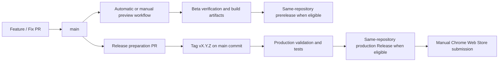

# Noir Wallet CI/CD and Release Workflow

This runbook describes the browser extension workflow implemented in [build-extension.yml](../.github/workflows/build-extension.yml). The [documentation workflow](../.github/workflows/docs.yml) verifies the documentation site on relevant pull requests but does not deploy it. The [SDK workflow](../.github/workflows/sdk.yml) checks the SDK package and example from this workspace without publishing them. SDK npm publication, website production deployment, and Chrome Web Store submission are separate manual operations.

## Branches and Releases

- `main` is the long-lived integration branch and should remain releasable. Submit features and fixes through short-lived pull request branches.
- Relevant pushes to `main` validate and build beta artifacts. A manual `workflow_dispatch` from `main` can also create a beta preview.
- The canonical `NoirWallet/noir-wallet` repository publishes wallet Releases even while private. Other public, non-fork repositories also publish to themselves. Forks and other private repositories retain Actions build artifacts without publishing Releases.
- Production is released by pushing a `v{version}` tag that points to a commit already contained in `main`.
- There is no long-lived `release` branch. Create a temporary `release/{version}` branch only when a version freeze is needed, and remove it after release.



### Beta triggers

A push to `main` triggers a beta when extension, workspace build configuration, changelog, WASM lock, test, or workflow paths match the workflow filter. A manual run must use `main`; other branches are rejected. Ignored local UI tools and `output/` are not committed or release triggers.

The workflow generates beta labels; do not create them manually:

```text
v{version}-beta.{UTC timestamp YYYYMMDDHHMM}.{short commit SHA}
```

For example: `v1.0.27-beta.202607221530.a1b2c3d`. A new run on the same `main` ref cancels an unfinished older beta run. Multiple betas can use the same extension version. In forks and private repositories other than `NoirWallet/noir-wallet`, this label identifies the Actions artifact; no Git tag or Release is created.

### Production tag validation

A pushed tag beginning with `v` enters the production flow only when:

1. The tag equals `v` plus the version in `packages/extension/package.json`.
2. Its commit is contained in `main`.
3. `CHANGELOG.md` has exactly one nonempty `## [version]` section for that version.
4. `packages/web/public/changelog.json` has a matching entry accepted by the wallet's release-notes parser.

Validation fails before building or publishing if any condition is unmet. New workflow runs do not cancel production runs.

## Workflow Stages

### Prepare

Read the extension version, determine the release type, then generate the beta label or validate the production tag, `main` ancestry, developer changelog, and user-facing update notes.

### Verify

Every run executes:

```bash
pnpm install --frozen-lockfile
pnpm verify-wasm-pkg
pnpm test
```

`verify-wasm-pkg` checks the vendored WASM provenance metadata, file inventory, sizes, and SHA-256 values against `wasm-package.lock.json`. CI does not build or download WASM; both network builds use the same committed package. Beta and production use the same deterministic core tests. UI, Playwright, and hardware checks are local development activities, not automated release gates.

Before promotion, run `pnpm audit --prod` and `pnpm audit` against the frozen lockfile. Review each reported dependency path and affected API against the shipped extension bundles; apply compatible fixes and assess any remaining findings before release.

### Build

After verification, both networks are built in order:

```bash
pnpm build:extension
pnpm build:extension:testnet
```

`BUILD_CHANNEL` is `beta` or `production`. Mainnet and testnet use separate output directories and ZIP assets. Pull requests run core tests and both extension builds without publishing or receiving release secrets.

The build job keeps read-only repository permissions. It uploads the two ZIPs, `SHA256SUMS`, and release notes as one Actions artifact, named with the beta label or production tag and run attempt. Artifact retention follows the repository's Actions settings.

Production mainnet builds require the repository secrets `GA_API_SECRET` and `CUSTOM_ANALYTICS_PASSWORD`. The workflow injects them as process environment variables; a missing value stops the build. Local default builds, beta builds, testnet builds, and local browser verification do not embed these values. For a manual production mainnet build, supply the same environment variables through your shell and set `BUILD_CHANNEL=production`.

Analytics values embedded in the extension are visible to its users. They must not grant privileged server access or be relied on as confidential authentication. Rotate previously committed values before exposing repository history, and configure the replacements in repository secrets without committing them.

### Publish

The publish job runs in `NoirWallet/noir-wallet` regardless of visibility, and in other public, non-fork repositories. It downloads the preceding job's exact artifact and checks `SHA256SUMS` before publishing to `github.repository`. Only this job receives `contents: write`; it uses the built-in `GITHUB_TOKEN` and does not publish the SDK. Releases in a private repository are visible only to people with repository access.

- Beta uses a prerelease and is not marked Latest. Its tag points to the wallet source commit that produced the ZIPs.
- Production uses the validated, existing `v{version}` tag and is marked Latest. Earlier prereleases remain available.
- Production notes come from the matching `CHANGELOG.md` section. Each Release includes a source commit link, both ZIPs, and `SHA256SUMS`.

Asset names are `noir-wallet-v{release-version}.zip` for mainnet and `noir-wallet-v{release-version}-testnet.zip` for testnet. An existing Release is left unchanged when a run is retried. GitHub's automatically attached source archives now come from the wallet repository at the release tag.

The SDK is maintained in `packages/sdk/` but keeps its own version and npm publication process. For historical stable wallet Releases migrated from [the former SDK repository](https://github.com/NoirWallet/noir-wallet-sdk/releases), copy the binary assets byte-for-byte and link each original Release and source commit in the migration notes. Migration tags in this repository point to its initial commit (`5d7fcf4`); their source archives are not snapshots of the historical wallet source. This workflow does not modify those Releases. The wallet download and repository entry points are [wallet builds](https://zknoir.com/beta/versions) and [wallet source](https://zknoir.com/github). Website builds target `NoirWallet/noir-wallet` by default; see the [website build configuration](../README.md#build).

## WASM Package Updates

The separate WASM repository builds its web package into `pkg/`. This repository commits the complete package at `packages/extension/src/lib/wasm-pkg/`. The root `wasm-package.lock.json` records the source commit and ref, build features, release artifact SHA-256, and individual file hashes.

Prefer an immutable published archive with its SHA-256:

```bash
pnpm update-wasm-pkg -- \
  --repository https://github.com/NoirWallet/zcash-wallet-wasm \
  --commit <full-commit-sha> \
  --ref <release-tag> \
  --features <comma-separated-features> \
  --artifact-url <https-url> \
  --artifact-sha256 <sha256>
```

If no artifact is published, build the target ref into the nested checkout's `pkg/` and adopt it explicitly:

```bash
pnpm update-wasm-pkg:local -- \
  --ref <branch-or-tag> \
  --features <comma-separated-features>
```

`pnpm sync-wasm-pkg` restores only the locked package and rejects source commits or `pkg/` hashes that differ from the lock. Run `pnpm verify-wasm-pkg` after an update. Submit the lock file and complete vendored package in the same pull request. Do not create feature-specific `pkg-voting` directories.

## Beta Procedure

1. Branch from the latest `main`, implement the change, and run relevant local checks.
2. Submit a pull request and merge it after review.
3. After all changes intended for the beta are merged, wait for the Build Extension workflow to validate and build.
4. Download the Actions artifact or, when a Release is published, the prerelease ZIPs, and test the affected wallet flows.

No version bump or manually created tag is required for each beta.

## Production Procedure

### 1. Prepare a release pull request

In a separate branch:

1. Set a new version in `packages/extension/package.json`, for example `1.0.27`.
2. Add exactly one nonempty `## [1.0.27]` section to `CHANGELOG.md`.
3. Add the matching user-facing update entry in `packages/web/public/changelog.json`, following the [release notes rules](../AGENTS.md#user-facing-release-notes).

Feature code should already have been merged through its own pull request. Before merging the release preparation, run:

```bash
pnpm test
pnpm build:extension
pnpm build:extension:testnet
```

### 2. Merge and accept the beta

Merge the release pull request to `main`. Wait for the Build Extension workflow and validate the generated mainnet and testnet ZIPs before production promotion. See [review responsibilities](../CONTRIBUTING.md#review-and-acceptance).

### 3. Create the production tag

After acceptance, create an annotated tag from the verified `main` commit:

```bash
git switch main
git pull --ff-only
git tag -a v1.0.27 -m "Release v1.0.27"
git push origin v1.0.27
```

Do not tag a feature branch, an unmerged commit, or an outdated local `main`.

### 4. Check publication

For a publishing repository, confirm the Prepare, Verify, Build, and Publish jobs succeeded in GitHub Actions. In the wallet repository's Releases page, check the source tag/commit, Latest status, both ZIP assets, and release notes against the changelog. Download `SHA256SUMS` beside the ZIPs and run `sha256sum --check SHA256SUMS` (or `shasum -a 256 --check SHA256SUMS` on macOS). Forks and private repositories other than `NoirWallet/noir-wallet` produce Actions artifacts only.

### 5. Submit to Chrome Web Store

Store submission is manual. Verify the production **mainnet** ZIP, `noir-wallet-v{version}.zip`, from the GitHub Release, and complete final acceptance on that build. Upload that same ZIP in Chrome Web Store Developer Dashboard, review the version, changed permissions, and release notes, then submit for review or staged rollout under the store configuration. Record the actual publication time after approval. Never upload the `-testnet.zip` asset to the production store listing.

## Failure Recovery

- **Beta test or build failure:** fix the issue and merge a new commit to `main` to generate a new beta. For a temporary GitHub or external-service failure, rerun the failed workflow. Keep an unusable beta for traceability; the next beta has a unique build label.
- **Production tag validation failure:** fix version or release-notes errors in a new pull request, merge to `main`, and use the correct new tag. If the tagged commit is not in `main`, merge the intended code through a pull request. Do not move a published tag or overwrite a published version.
- **Production test, build, or infrastructure failure:** if the tag, commit, version, and release notes are correct and release content has not changed, rerun the failed GitHub Actions job. A publication retry uses the retained build artifact and skips an existing Release. If that artifact expired, rerun the build and publication jobs and verify the new checksums before store submission.
- **Incorrect published Release:** stop promoting it and release a new patch version. Do not reuse or move the old tag.

For an urgent fix, branch from current `main`, add the fix and a regression test, update the patch version and changelog, merge through a pull request, validate the beta, and tag the new version. An extension already published in the browser store cannot be rolled back in place; publish a new patch version.

## Pre-Release Checks

- [ ] All intended code is merged to `main`.
- [ ] Extension version is new and unpublished.
- [ ] Changelog has exactly one matching, nonempty version section.
- [ ] User-facing update notes match the version and visible changes.
- [ ] The `main` Build Extension workflow succeeded.
- [ ] Mainnet and testnet beta ZIPs passed acceptance.
- [ ] Production tag points to the accepted `main` commit.
- [ ] Production workflow succeeded.
- [ ] Wallet source tag/commit, both GitHub Release ZIPs, checksums, and release notes were checked.
- [ ] Final acceptance used the production ZIP intended for Chrome Web Store.
- [ ] Mainnet ZIP was submitted to Chrome Web Store.

Chrome Web Store upload and approval, SDK npm publishing, website production deployment, tag creation, and production release approval remain manual. Do not add unverified secret names or third-party publication actions to the workflow.
